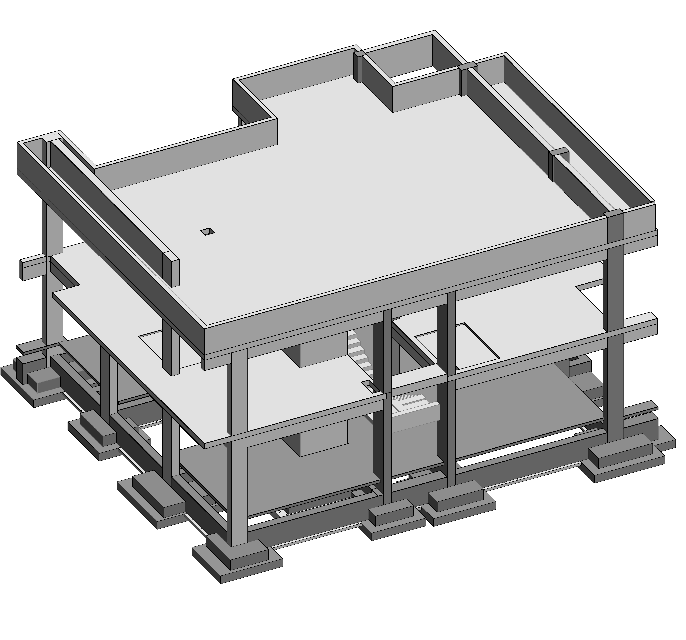

# Khalid Atef Mohammed | Structural BIM Engineer

Civil engineer with ~4 years of experience on large-scale residential and commercial projects in Giza, Egypt. I deliver structural BIM models and coordinated documentation using **Revit**, **Navisworks**, and **AutoCAD**.

📍 Giza, Egypt
🔗 LinkedIn: www.linkedin.com/in/khalid-atef-el-bhnsawy
🔗 Upwork: https://www.upwork.com/freelancers/~0145cea5ca6acc627b?mp_source=share
📧 Email: khalidatef612@gmail.com

---

## What I Do

- 3D structural modeling in Revit
- Schedule sheets and shop drawing sheets
- Rebar quantity takeoff (bar bending schedules)
- Clash detection and coordination in Navisworks

---

## Projects

### 01 | Marble Factory

Reinforced-concrete administration building plus a steel-frame factory building-with flat slab structural system.

**My role:** 3D structural model, schedule sheets, shop drawings, rebar quantities, Navisworks clash detection.
**Tools:** Revit, Navisworks· AutoCAD
📄 [Drawing set (PDF)](01-marble-factory/drawings.pdf)

### 02 | School Project

Multi-storey RC school with curved slab edges and full rebar detailing-with flat slab structural system.

**My role:** 3D structural model, schedule sheets, shop drawings, rebar quantities, Navisworks clash detection.
**Tools:** Revit, Navisworks· AutoCAD
📄 [Drawing set (PDF)](02-school/drawings.pdf)

### 03 | Villa

[Reinforced-concrete villa, from footings to staircase-flat slab structural system.

**My role:** 3D structural model, schedule sheets, shop drawings, rebar quantities, Navisworks clash detection.
**Tools:** Revit, Navisworks
📄 [Drawing set (PDF)](03-villa/drawings.pdf)

## Contact

Open to freelance and full-time BIM work. Reach me on LinkedIn or by email.
